> **Status update — 9 November 2026.** Registration for Tracks 02 and 03 was accepted by Codabench on 30 October. Track 03 sealed submissions remain postponed, with no confirmed opening date; the organiser will announce the opening. No sealed submission receipt or score has been verified in this recovery. Historical public warm-up results do not determine the final ranking. See the [current rules](https://neural-interfaces26.github.io/rules.html) and [Track 03 Scientific FAQ](https://github.com/neural-interfaces26/2026-competition/blob/main/codabench/pages/scientific_faq_sleep.md).
>
> The current evaluation limit is **60 minutes on one A100**. The original narrative below is retained as a historical research record: its 80-minute limit and “nothing submitted yet” badge are dated statements. A historical local checkpoint reports a completed warm-up entry; this recovery has not independently rechecked that entry in the authenticated submission history.
>
> Thirteen synthetic CPU component checks passed for the existing model definitions and captured official streaming helpers: output shape and bounds, resets, prefix causality, recording isolation, batch partitions and four deliberate error cases. This does **not** validate the complete submission ZIP, Solver, worker, dataset pipeline, objective, metric or predictive utility. Benchopt and NeuralBench were unavailable in the inspected server environment; the full worker was not run. No model was retrained, no dataset or study test was opened, and no GPU computation was used in this recovery.

---

<div align="center">

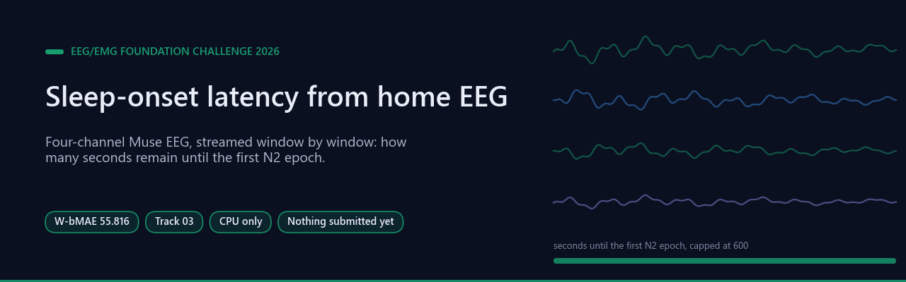

# Sleep-Onset Latency from Four-Channel Home EEG (Track 03)

[](LICENSE) [](experiments/official_check.json) [](submissions/METHOD.md)   [](https://nemar.org/dataexplorer/detail?dataset_id=nm000287) [](https://neural-interfaces26.github.io/)

[**Headline result**](#headline-result) · [**How it works**](#how-it-works) · [**Results in full**](#results-in-full) · [**Observations**](#observations) · [**Method**](submissions/METHOD.md) · [**Experiment log**](experiments/LOG.md) · [**Bibliography**](#bibliography)

</div>

Entry for **Track 03 — Sleep onset** of the [EEG/EMG Foundation Challenge
2026](https://neural-interfaces26.github.io/) (NeuralBench, Brain & Body Workshop at
NeurIPS 2026). From four-channel at-home Muse EEG, predict how many seconds remain until
the sleeper's first N2 epoch, capped at 600 s. Ranking metric: **W-bMAE per recording,
averaged over recordings** (lower is better).

Author: Francisco Angulo de Lafuente ([Agnuxo](https://github.com/Agnuxo1)), Madrid.
Licence: Apache-2.0.

---

**Contents** — [Headline result](#headline-result) · [How it works](#how-it-works) · [Background](#background) · [Results in full](#results-in-full) · [Reproducing](#reproducing) · [Observations](#observations) · [Real-world applications](#real-world-applications) · [Possible improvements](#possible-improvements) · [Future work](#future-work) · [Bibliography](#bibliography)

<!-- impact-note:start -->
<sub><strong>Efficiency and practical value.</strong> Correct chronological training replaces a sampled, shuffled cache with complete streams, aligning the lightweight linear model with its inference setting. The repository reports a reduction in public-training CV macro error from 50.9290 to 48.9164 seconds against the historical fit. The <a href="research/r01_20261110/README.md">R01 study</a> documents this CPU-trained correction and rejects the nonlinear alternative; these CV results remain distinct from its official sealed score and unmeasured clinical or energy benefits.</sub>
<!-- impact-note:end -->

## Headline result

<p align="center">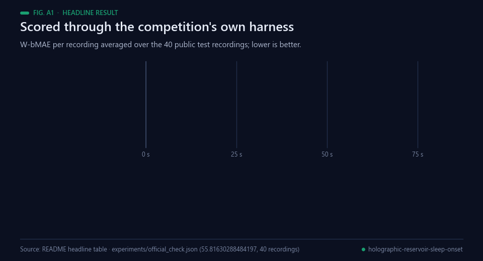<br><sub>Animated figure A1 — Public test split, lower is better. Data: the table below and experiments/official_check.json.</sub></p>

**W-bMAE 55.816 on the public test split, scored through the competition's own evaluation
harness — 4.3 s better than the best published baseline.**

| System | W-bMAE (s) |
|---|---|
| **This entry** | **55.82** |
| CTNet (published by the organisers) | 60.10 |
| EEGNet (published by the organisers) | 60.60 |
| Constant 35 s (replayed on the same public recordings) | 60.74 |

The paired replay used official kit revision `423b5af` on 40 public warm-up
recordings (5,869 windows). The explicit-memory model reduced W-bMAE by
8.1% versus the fixed 35-second prediction and had lower error on 32 of
40 recordings. These are descriptive public results. Sealed-phase
performance is unknown. [Measured results](experiments/paired_control_20261104.json)

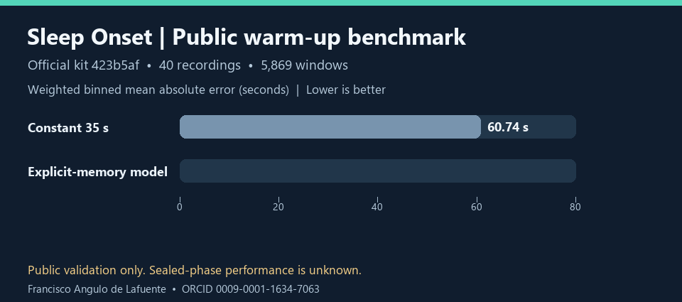
| REVE, fine-tuned (published by the organisers) | 72.90 |

That number is not self-reported from my own scoring code: `code/verify_official.py` loads
the built submission exactly as the platform does and scores it with the kit's own
`predict_streams` and `binned_mae` over the 40 public test recordings. It reproduces the
offline figure to the third decimal.

Under five-fold cross-validation on the training release the same system reaches **51.21 ±
1.44** with participants held out entirely, and **50.06 ± 2.05** on held-out recordings of
participants seen in training — roughly 10 s below the published floor in both regimes.

It is also cheap to run: the submission is **7.6 kB**, imports nothing but numpy, and
scores the whole public test split in **11.9 s** against a limit of 80 minutes on one
A100. Training used **CPU only** — no GPU at any point, for any model in this repository.

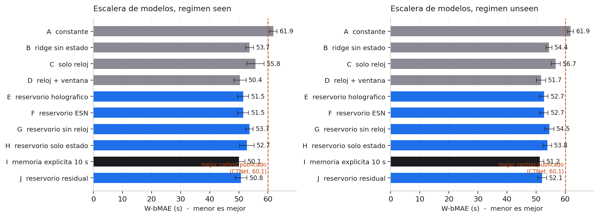

## How it works

<p align="center">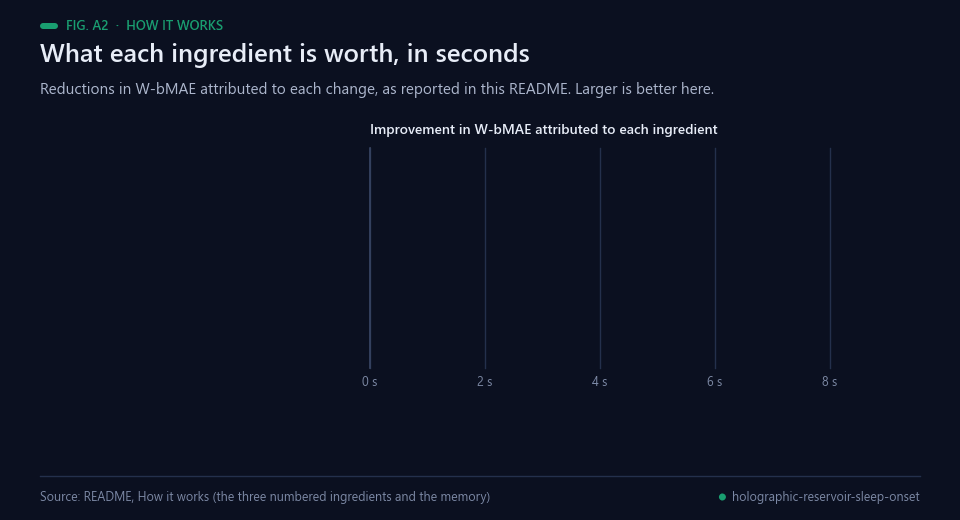<br><sub>Animated figure A2 — What each ingredient contributes. Data: this section's own numbers.</sub></p>

Three ingredients, in order of how much each is worth.

<p align="center">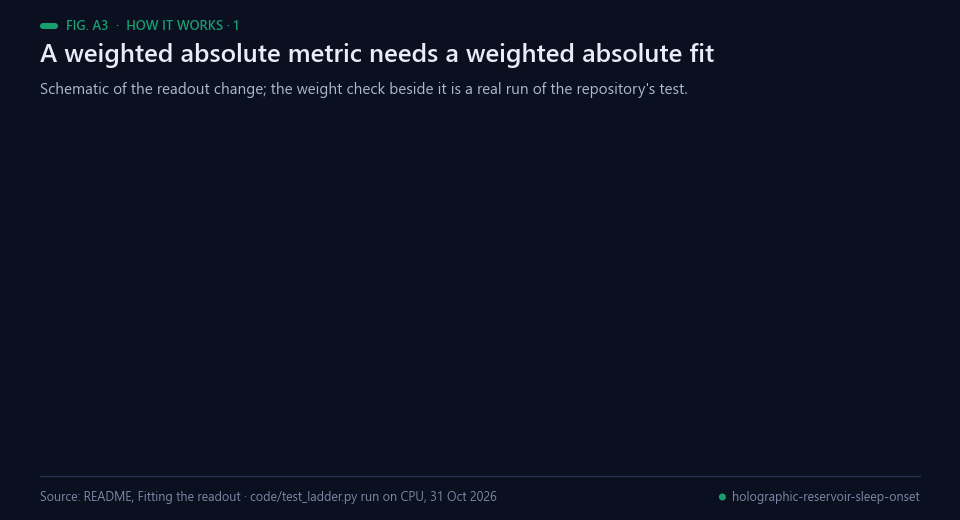<br><sub>Animated figure A3 — Schematic of the fit, plus a real run of code/test_ladder.py.</sub></p>

**1. Fitting the readout to the competition's actual loss (−5.8 s).** The ranking metric is
a *weighted absolute* error; a ridge minimises a squared one. Each window is given the
weight that makes a weighted mean absolute error equal the ranking metric exactly, and the
linear readout is then fitted by iteratively reweighted least squares. This single change
is worth more than any architecture tried here.

<p align="center">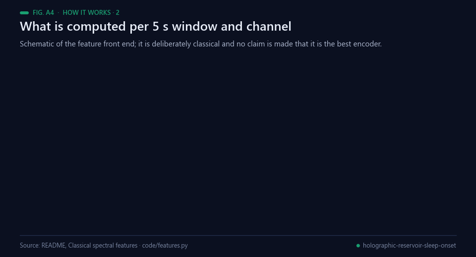<br><sub>Animated figure A4 — Schematic of the feature front end. Source: code/features.py.</sub></p>

**2. Classical spectral features (−7.5 s against the constant).** Per 5 s window and
channel: log and relative band powers in delta, theta, alpha, sigma and beta; four log
ratios that track drowsiness; Hjorth activity, mobility and complexity; and a clipping
flag, since the recordings are raw and one blink otherwise dominates every power.

**3. The clock the streamed harness makes available (−2.7 s more).** The target is
`y(t) = min(600, D − t)`, with `t` the time elapsed since the recording started and `D` the
first N2 epoch. The official harness
([`benchmark_utils/streaming.py`](https://github.com/neural-interfaces26/2026-competition))
feeds each recording's windows one at a time, in time order, from the start of the
recording, deep-copies the model per recording and calls `reset_state()` first — its own
docstring says *"A model can adapt within a stream."* So a model that keeps state knows `t`
by counting its own calls: causal, nothing from the future. A per-window decoder cannot.

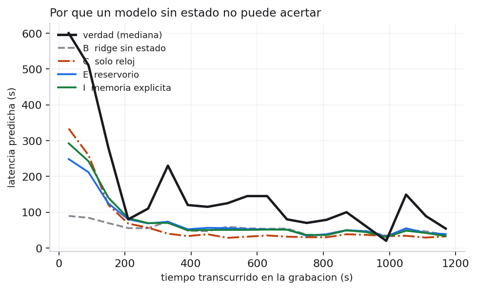

A short memory on top of that — one exponential moving average of the features with a 10 s
half-life, cleared between recordings — adds a further 0.5 s and wins in all ten
cross-validation folds of both regimes.

Nothing here touches the sealed split, uses non-permitted data or modifies the scoring
harness (rule 06). It uses the state the harness explicitly offers.

## Background

<p align="center">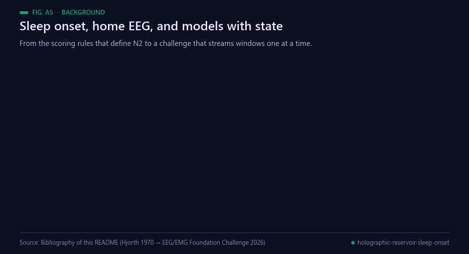<br><sub>Animated figure A5 — Milestones behind this work. Sources: bibliography below.</sub></p>

Sleep onset is not an instant. Reviewing behavioural, EEG, physiological and subjective measures together,
Ogilvie concluded that entry into sleep is a continuous, interwoven series of changes beginning in relaxed
drowsiness rather than something that happens in a moment [[14](#ref-14)]. What the scoring rules fix is a
convention on top of that process: the visual scoring standard defines the stages, and the first N2 epoch —
the target here — is the point those rules identify [[4](#ref-4)]. The EEG markers used in this repository are
long-standing ones: the sigma activity of sleep spindles is the characteristic feature of stage 2
[[13](#ref-13)], and Hjorth's time-domain descriptors of activity, mobility and complexity date from 1970
[[12](#ref-12)], computed here over Welch-style windowed spectra [[16](#ref-16)] — the band powers, ratios and Hjorth
parameters of `code/features.py`.

What is new is where the measurement happens. The recordings are at-home, four-channel Muse data
[[2](#ref-2)], and that class of consumer headband has been validated for research use rather than assumed
adequate [[3](#ref-3)]. Track 03 of the EEG/EMG Foundation Challenge asks for the seconds remaining until the
first N2 epoch, scored as a weighted binned absolute error per recording [[1](#ref-1)]. The baselines the
organisers published are the field's standard decoders — EEGNet, a compact convolutional network for EEG
[[5](#ref-5)], CTNet, a convolutional transformer built for EEG decoding [[6](#ref-6)], and REVE, a pretrained EEG
foundation model [[7](#ref-7)] — and none of them separates itself from a constant.

This repository's explanation for that is structural, and it is the reason the entry keeps state. The
official harness feeds each recording's windows one at a time, in time order, and calls `reset_state()`
between recordings, so a model that keeps state can count its own calls and knows the elapsed time, while a
per-window decoder cannot. The alternative way to keep state was the author's own one: echo state networks
train only a linear readout over a fixed random recurrent state [[8](#ref-8)], a family surveyed in [[9](#ref-9)],
and `holographic-reservoir` is that family with SHA-256-derived entropy on the recurrent diagonal
[[10](#ref-10)]. It was measured against the same control and it lost; the fit itself was then changed instead,
from a squared-error readout to iteratively reweighted least squares [[11](#ref-11)], which is what matched the
ranking metric [[15](#ref-15)].

## Results in full

<p align="center">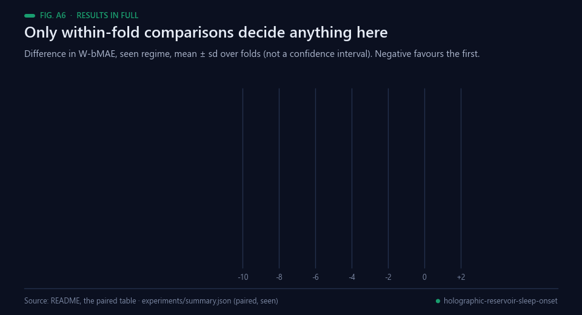<br><sub>Animated figure A6 — Within-fold differences, mean ± sd over folds. Data: the paired table below and experiments/summary.json.</sub></p>

Five-fold cross-validation, two regimes, three seeds for every model with a random
substrate. `seen` holds out recordings of participants kept in training; `unseen` holds out
whole participants.

| Model | seen | unseen |
|---|---|---|
| **I explicit 10 s memory (submitted)** | **50.06 ± 2.05** | **51.21 ± 1.44** |
| D clock + window | 50.41 ± 2.09 | 51.73 ± 1.57 |
| J reservoir as a correction | 50.77 ± 1.99 | 52.11 ± 1.47 |
| F plain ESN | 51.47 ± 1.82 | 52.71 ± 1.37 |
| E holographic reservoir | 51.47 ± 1.82 | 52.72 ± 1.37 |
| H reservoir, state only | 52.75 ± 2.43 | 53.84 ± 1.37 |
| G reservoir, no clock | 53.69 ± 1.08 | 54.55 ± 1.40 |
| B stateless ridge | 53.69 ± 1.42 | 54.40 ± 1.01 |
| C clock only | 55.76 ± 2.98 | 56.75 ± 1.56 |
| A constant | 61.89 ± 1.29 | 61.88 ± 1.02 |

Fold-to-fold variation is ±1.5–2.5 s, larger than the gaps between the leading models, so
the comparisons that decide anything are the ones made *within* each fold, where the
held-out recordings are the same for both models (negative favours the first):

| Comparison | seen | unseen | folds won |
|---|---|---|---|
| B − A — adding the EEG features | −8.20 ± 1.34 | −7.48 ± 0.69 | 5 of 5 |
| C − A — the clock on its own | −6.12 ± 2.45 | −5.13 ± 2.22 | 5 of 5 |
| D − B — adding the clock | −3.28 ± 2.55 | −2.67 ± 1.56 | 5 of 5 |
| I − D — adding the 10 s memory | −0.35 ± 0.16 | −0.52 ± 0.24 | 5 of 5, 5 of 5 |
| H − E — removing the current window | +1.28 ± 0.67 | +1.12 ± 0.28 | 0 of 5 |
| E − D — the reservoir against the control | +1.06 ± 0.77 | +0.99 ± 1.02 | 1 of 5 |
| E − F — the SHA-256 entropy term | +0.00 ± 0.00 | +0.00 ± 0.00 | 0 of 5 |

## Reproducing

<p align="center">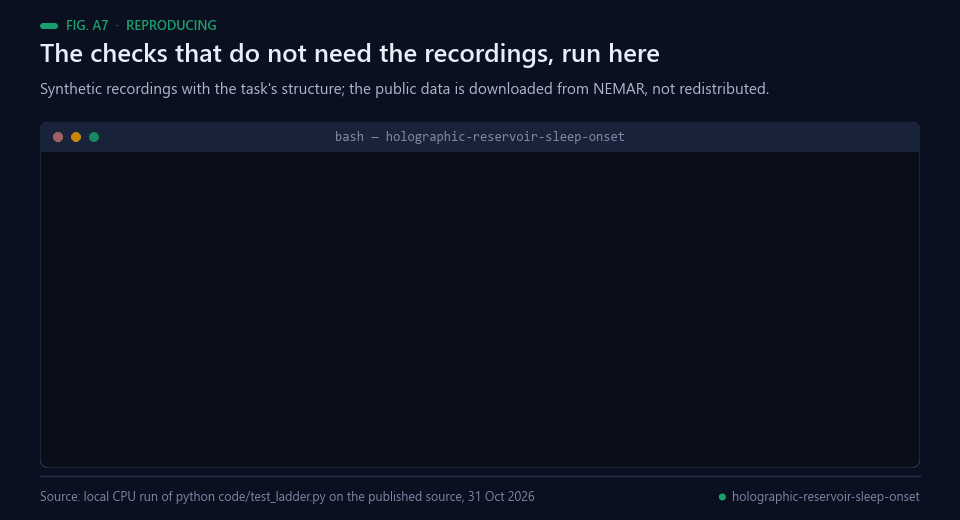<br><sub>Animated figure A7 — A real CPU run of the repository's own checks, 31 Oct 2026. The program's output is its own, in Spanish.</sub></p>

The public data (NEMAR `nm000287`, 540 recordings, ~1.1 GB) is **not** redistributed here:
it is downloaded from NEMAR under its own terms, and no signal, feature cache or
participant-level artefact from it is committed to this repository.

```bash
pip install -r requirements.txt
python code/prepare_data.py        # downloads NEMAR nm000287 (~1.1 GB)
python code/extract_cache.py       # per-window spectral features -> cache/
python code/run_cv.py --folds 5 --seeds 0 1 2
python code/build_submission.py --out submissions/memoria_explicita
python code/verify_official.py --submission submissions/memoria_explicita
```

`code/test_ladder.py` checks the parts that are easy to get silently wrong: that the sample
weights reproduce the ranking metric exactly, and that predicting one window at a time —
with a deep copy and `reset_state()` per recording, as the platform does — matches the
offline fit to 1.4e-14, for the submitted model and for the reservoir.

### Environment notes

- `code/kit_compat.py` works around version skews between the starting kit (branch `main`)
  and the `neuralbench==0.4.0` the kit itself pins, plus `os.pwrite`, which does not exist
  on Windows. None of the patches changes any data or split.
- Window extraction needs `NEURALBENCH_EXTRACT_CPUS=1` on a machine with a modest pagefile:
  the default spawns one torch-loading worker per core.

---

## Observations

Things that did not work, or that qualify the result above. None of them changes the
headline, and all of them are reported because leaving them out would be picking the data.

<p align="center">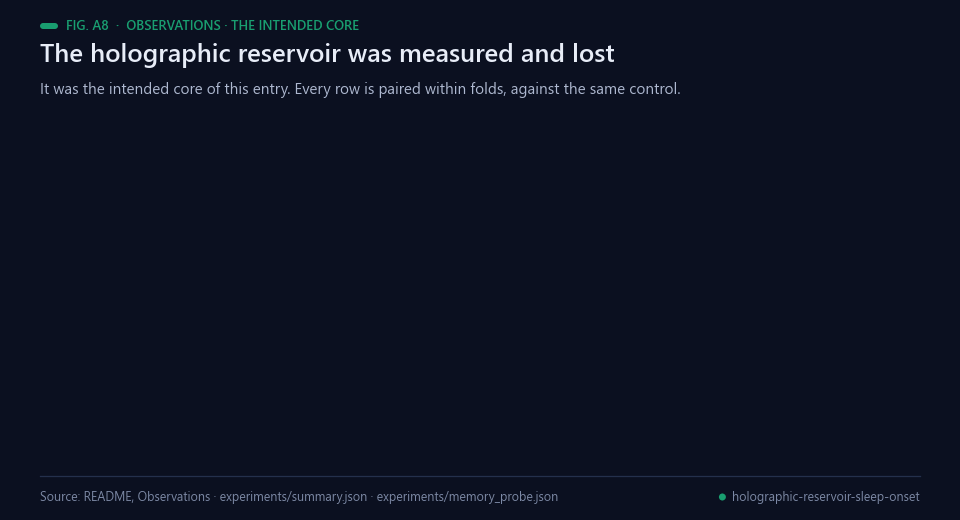<br><sub>Animated figure A8 — The intended core, measured and rejected. Data: experiments/summary.json and experiments/memory_probe.json.</sub></p>

**The Holographic-Reservoir did not contribute.** The author's
[Holographic-Reservoir](https://pypi.org/project/holographic-reservoir/) — a sparse
expander-graph reservoir with deterministic SHA-256 entropy on its diagonal, read out
linearly — was the intended core of this entry, and on paper it fits a streamed task well.
Measured against the same control under the same validation and compute, it came out 1.0 s
*worse* and lost in four folds of five in both regimes. As a correction on top of the
control it still lost by 0.4 s. The sweep was blunter: the shorter its memory, the better
it scored — at a leak of 0.1 it reached 80–112 s, at 0.7 it merely tied. The likely cause
is that its state dimensions are strongly autocorrelated and ill-condition the fit; it
degrades the readout even on training data, so this is not overfitting. It is kept in the
repository, implemented and tuned, because the measurement is worth having.

**The SHA-256 entropy term is not measurable.** E − F is `+0.00 ± 0.00` in both regimes:
adding that entropy to the recurrent matrix's diagonal gives the same score to the last
decimal as leaving it out. What remains is an echo-state network.

<p align="center"><br><sub>Animated figure A9 — What does not fit the headline. Data: this section and experiments/official_check.json.</sub></p>

**One number points the other way.** On the public test split the reservoir scores 55.741,
0.08 s *better* than the submitted model — the opposite of the cross-validation ordering.
With 40 recordings that difference is noise, but it is there.

**The clock assumes the sealed streams start where the public ones do.** If the sealed
cohort's windows were trimmed differently, the elapsed-time counter would be biased and
part of the advantage would go; model G is the variant that does not depend on it.

**Scope.** Everything is validated on the public Muse split; the sealed cohort is private.
The feature front end is deliberately classical and no claim is made that it is the best
possible encoder. No leaderboard position is claimed: nothing has been submitted at the
time of writing.

## Real-world applications

<p align="center">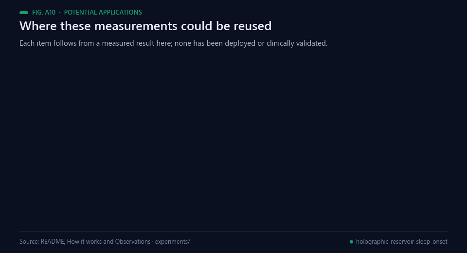<br><sub>Animated figure A10 — Potential reuse. Nothing here has been deployed or clinically validated.</sub></p>

Insomnia symptoms are reported by about a third of the general population in epidemiological surveys
[[15](#ref-15)], and sleep latency is one of the quantities those surveys turn on, so a latency estimate from a
headband people already own is a plausible thing to want. None of the following has been built, deployed or
clinically validated; each is a use the measurements here would support.

- **Latency estimates on the device.** The submission is 7.6 kB, imports nothing but numpy, and scores the
  40 public test recordings in 11.9 s, so the same model would run on a phone beside the headband
  [[2](#ref-2), [3](#ref-3)].
- **Fitting the readout to the metric that ranks.** Reweighting a linear readout so a weighted mean absolute
  error equals the ranking metric exactly [[11](#ref-11)] was worth more here (−5.8 s) than any architecture
  tried, and the same mismatch between a training loss and a scored quantity is a documented source of
  misleading results [[15](#ref-15)].
- **Honest ablations of streamed models.** Separating the clock from the EEG shows how much of a streamed
  model's advantage is arithmetic rather than signal — a distinction that matters whenever a benchmark feeds
  windows in time order [[1](#ref-1)].
- **A worked negative for reservoir computing.** The reservoir is kept in the repository, implemented and
  tuned, with the numbers that rejected it on this task [[8](#ref-8), [9](#ref-9), [10](#ref-10)].
- **Streaming-contract checks before submitting.** `code/test_ladder.py` catches a model that would score
  differently online than offline, which is the quiet failure mode of a stateful entry.
- **A classical reference for learned encoders.** Band powers and Hjorth parameters [[12](#ref-12), [13](#ref-13)] give a
  transparent front end against which a learned encoder [[5](#ref-5), [6](#ref-6), [7](#ref-7)] can be compared on the same
  folds.

## Possible improvements

<p align="center">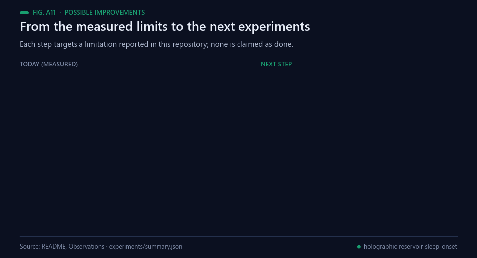<br><sub>Animated figure A11 — Each improvement targets a limitation reported in this repository.</sub></p>

- **Test the clock assumption instead of carrying it.** The elapsed-time counter assumes the sealed streams
  start where the public ones do. Model G is the variant that does not depend on it, and submitting both
  would settle the question rather than leave it as a caveat.
- **Make the comparisons larger than their spread.** Fold-to-fold variation is ±1.5 to 2.5 s, larger than the
  gaps between the leading models, which is why only within-fold differences are used. More folds or more
  seeds would let the summary numbers carry weight too.
- **Attack the reservoir's conditioning, not its hyper-parameters.** The stated cause of its loss is that its
  state dimensions are strongly autocorrelated and ill-condition the fit, and it degrades the readout even on
  training data. Whitening the state before the readout tests that explanation; another sweep of leak and
  spectral radius does not [[9](#ref-9)].
- **Compare the classical front end with a learned encoder under this protocol.** The feature set is
  deliberately classical and no claim is made that it is the best encoder; EEGNet, CTNet and REVE
  [[5](#ref-5), [6](#ref-6), [7](#ref-7)] were run by the organisers on their own terms, not within these folds.
- **Report the uncertainty the way the sample supports.** With 40 public test recordings a 0.08 s difference
  is noise; a resampling interval over recordings [[12](#ref-12)] would make that explicit next to the headline.

## Future work

<p align="center">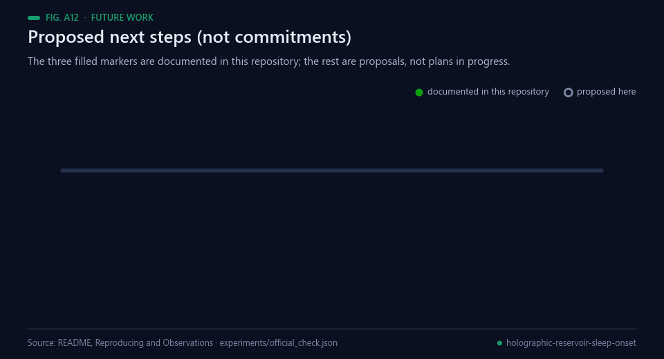<br><sub>Animated figure A12 — The three filled markers are documented in this repository; the rest are proposals.</sub></p>

Proposed next steps, not commitments. Only the first three are documented in this repository as done; the
others are proposals and none is claimed as started:

1. *Documented.* The ranking metric was reimplemented and checked identical to the kit's own on random
   inputs, difference 0 (`experiments/LOG.md`).
2. *Documented.* The ten-model ladder was measured in both regimes, five folds, three seeds for every model
   with a random substrate (`experiments/summary.json`).
3. *Documented.* The built submission was scored through the competition's own evaluation harness at 55.816
   over the 40 public test recordings (`experiments/official_check.json`).
4. Submit; nothing had been submitted at the time of writing, so no leaderboard position exists
   [[1](#ref-1)].
5. Submit model G as well, so the clock assumption is tested rather than assumed.
6. Run a learned encoder [[5](#ref-5), [6](#ref-6), [7](#ref-7)] through the same streamed harness and the same folds, and
   report it within-fold like the rest.

## Bibliography

1. <a id="ref-1"></a>NeuralBench organizers (2026). *EEG/EMG Foundation Challenge 2026* (Brain & Body Workshop, NeurIPS 2026), Track 03 — Sleep onset. https://neural-interfaces26.github.io/
2. <a id="ref-2"></a>Muse Team (2026). *Muse Sleep-Onset EEG — EEG/EMG Foundation Challenge 2026, Track 03*. NEMAR (Neuroelectromagnetic Data Archive and Tools Resource). https://doi.org/10.82901/nemar.nm000287
3. <a id="ref-3"></a>Krigolson, O. E., Williams, C. C., Norton, A., Hassall, C. D., & Colino, F. L. (2017). Choosing MUSE: Validation of a Low-Cost, Portable EEG System for ERP Research. *Frontiers in Neuroscience*, 11. https://doi.org/10.3389/fnins.2017.00109
4. <a id="ref-4"></a>Silber, M. H., Ancoli-Israel, S., Bonnet, M. H., et al. (2007). The Visual Scoring of Sleep in Adults. *Journal of Clinical Sleep Medicine*, 3(2), 121–131. https://doi.org/10.5664/jcsm.26814
5. <a id="ref-5"></a>Lawhern, V. J., Solon, A. J., Waytowich, N. R., et al. (2018). EEGNet: a compact convolutional neural network for EEG-based brain–computer interfaces. *Journal of Neural Engineering*, 15(5), 056013. https://doi.org/10.1088/1741-2552/aace8c
6. <a id="ref-6"></a>Zhao, W., Jiang, X., Zhang, B., Xiao, S., & Weng, S. (2024). CTNet: a convolutional transformer network for EEG-based motor imagery classification. *Scientific Reports*, 14(1). https://doi.org/10.1038/s41598-024-71118-7
7. <a id="ref-7"></a>El Ouahidi, Y., Lys, J., Thölke, P., et al. (2025). REVE: A Foundation Model for EEG - Adapting to Any Setup with Large-Scale Pretraining on 25,000 Subjects. *Advances in Neural Information Processing Systems 38*, 25583–25619. https://doi.org/10.52202/085713-0760
8. <a id="ref-8"></a>Jaeger, H., & Haas, H. (2004). Harnessing Nonlinearity: Predicting Chaotic Systems and Saving Energy in Wireless Communication. *Science*, 304(5667), 78–80. https://doi.org/10.1126/science.1091277
9. <a id="ref-9"></a>Lukoševičius, M., & Jaeger, H. (2009). Reservoir computing approaches to recurrent neural network training. *Computer Science Review*, 3(3), 127–149. https://doi.org/10.1016/j.cosrev.2009.03.005
10. <a id="ref-10"></a>Angulo de Lafuente, F. (2026). *holographic-reservoir* (Python package, Apache-2.0). https://pypi.org/project/holographic-reservoir/
11. <a id="ref-11"></a>Holland, P. W., & Welsch, R. E. (1977). Robust regression using iteratively reweighted least-squares. *Communications in Statistics - Theory and Methods*, 6(9), 813–827. https://doi.org/10.1080/03610927708827533
12. <a id="ref-12"></a>Hjorth, B. (1970). EEG analysis based on time domain properties. *Electroencephalography and Clinical Neurophysiology*, 29(3), 306–310. https://doi.org/10.1016/0013-4694(70)90143-4
13. <a id="ref-13"></a>De Gennaro, L., & Ferrara, M. (2003). Sleep spindles: an overview. *Sleep Medicine Reviews*, 7(5), 423–440. https://doi.org/10.1053/smrv.2002.0252
14. <a id="ref-14"></a>Ogilvie, R. D. (2001). The process of falling asleep. *Sleep Medicine Reviews*, 5(3), 247–270. https://doi.org/10.1053/smrv.2001.0145
15. <a id="ref-15"></a>Ohayon, M. M. (2002). Epidemiology of insomnia: what we know and what we still need to learn. *Sleep Medicine Reviews*, 6(2), 97–111. https://doi.org/10.1053/smrv.2002.0186
16. <a id="ref-16"></a>Reinke, A., Tizabi, M. D., Baumgartner, M., et al. (2024). Understanding metric-related pitfalls in image analysis validation. *Nature Methods*, 21(2), 182–194. https://doi.org/10.1038/s41592-023-02150-0
17. <a id="ref-17"></a>Kaufman, S., Rosset, S., Perlich, C., & Stitelman, O. (2012). Leakage in data mining. *ACM Transactions on Knowledge Discovery from Data*, 6(4), 1–21. https://doi.org/10.1145/2382577.2382579

---

<div align="center">
<sub>Built by <a href="https://github.com/Agnuxo1">Francisco Angulo de Lafuente</a> · every figure is an animated
rendering of the published file named in its footer · <a href="#sleep-onset-latency-from-four-channel-home-eeg-track-03">back to top ↑</a></sub>
</div>


## Verified update — 10 November 2026

Track 03 is open. The corrected chronological linear model completed the
official sealed evaluation as submission **1046573**: **49.82 s W-bMAE macro**,
with a visible position of **38/45 at observation**, not a final award.
The [dated R01 report, code and receipts](research/r01_20261110/README.md)
supersede the earlier postponed status and qualify the historical CV claims.

The audit found that the old training cache had been sampled with replacement
and was not chronological. Reconstructing every training index once improved
the fixed public-training CV macro from 50.9290 to 48.9164 s; the paired 97.5%
participant interval for the 2.0126 s gain is [1.1721, 2.8319] s. The nonlinear
residual failed the fixed unseen/CI gates and was rejected. No raw EEG,
feature caches, targets, identifiers or hidden evaluation data are published.
The original narrative and all GIFs below/above remain historical records
of the old model; old sampled-cache CV does not prove streaming parity.

The selected weights were reproduced bit-for-bit and the exact final ZIP
passed the real public worker and independent review before one official
upload. Code and aggregate evidence are public; the exact model archive is
backed up privately. Local CV, technical checks and the official result are
reported separately. Full author attribution and source hashes are included.

<!-- author-background:start -->
## Author background

**Francisco Angulo de Lafuente**, independent AI researcher · [ORCID](https://orcid.org/0009-0001-1634-7063) · [arXiv](https://arxiv.org/a/angulodelafuente_f_1.html) · [Google Scholar](https://scholar.google.com/citations?user=6nOpJ9IAAAAJ) · [ResearchGate](https://www.researchgate.net/profile/Francisco-Angulo-Lafuente-3) · [Figshare](https://figshare.com/authors/Francisco_Angulo_de_Lafuente/22601234) · [Wikipedia](https://es.wikipedia.org/wiki/Francisco_Angulo_de_Lafuente)

Earlier research at ECOFA focused on biotechnology for clean energy and on second-generation biofuels obtained by microbiological processing of organic waste. Two Spanish patents document that work:

- **ES 2273594 B1**, *Process for obtaining fuels from organic waste*. Filed 5 September 2005, grant published 16 February 2008. [OEPM](https://www.oepm.es/pdf/ES/0000/000/02/27/35/ES-2273594_B1.pdf) · [Google Patents](https://patents.google.com/patent/ES2273594B1/en)
- **ES 2341194 B1**, *Method for obtaining paraffin by a biological process with microorganisms from organic matter, and its refining for use as fuel*. Filed 11 September 2007, grant published 26 April 2011. Also published as EP2196519 and WO2009034217. [OEPM](https://www.oepm.es/pdf/ES/0000/000/02/34/11/ES-2341194_B1.pdf) · [Google Patents](https://patents.google.com/patent/ES2341194B1/en)

These are historical publication and grant records under the inventor name Francisco Angulo Lafuente, and both have since lapsed. They are cited as evidence of a research trajectory and make no statement about current enforceability.
<!-- author-background:end -->
